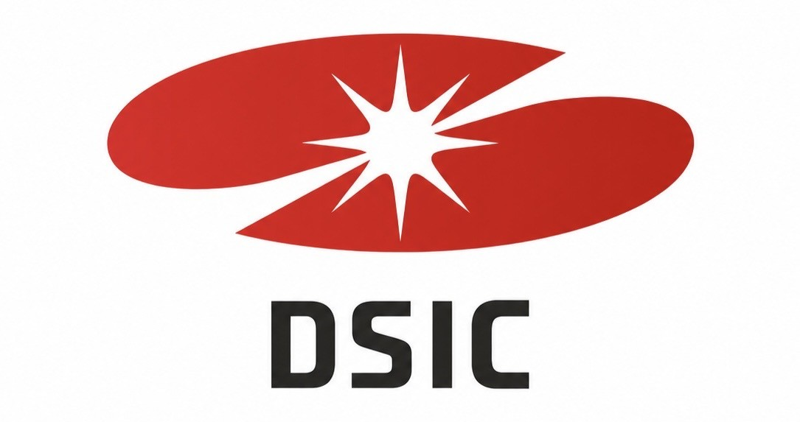

# DSIC



**Dual Scale Inversion Cosmology (DSIC)** is a cosmological model in which the Universe has no absolute scale. Cosmic acceleration is geometric: no dark-energy component is introduced.

Space and objectness (everything that exists in space) are treated as two poles of one conserved norm, `S² + O² = R²`. The objectness fraction `μ = |O|/R` flows uniformly. An observer is itself built of objectness and sees only the moduli of the poles. Its rod and clock fix the observable scale factor `b(μ) = √(1−μ²)/μ²`, and redshift, kinematics and distances follow from it. Acceleration is the divergence of the two scale factors seen from inside. It begins at `μ² = 3 − √5`, which corresponds to `z_t ≈ 0.77`. The late Universe has one shape parameter, the present phase `μ₀`. With `H₀` this makes two parameters, the same as flat ΛCDM.

The early Universe follows from one more principle, P6. Matter is contained in space and cannot leave it, so when the scale of space is small, matter is compressed as in a press. The binding mass of the core has a single minimum, at the point where its deceleration is `q = ½`. That point is `κ_h² = 4 + 2√7`, or `z_h ≈ 2.26`. The compressed phase switches on there, and the amount of matter is fixed by the core, so there is no free `Ω_m`. Internal time in compressed matter runs faster, by up to a factor `Σ ≈ 24.6`. This restores the standard expansion rate at nucleosynthesis. One rate formula covers the whole history from the zero of space to today. Rewritten in dark-energy language, it gives `w(0) ≈ −0.92` and a crossing of `w = −1` at `z ≈ 0.27`. That is the direction DESI points to. The density of this effective dark energy vanishes at the switch point.

Every step in the paper carries a status: postulate, derived, tested on data, open, or against the model.

---

## Repository structure

```
DSIC_3_ru_en-Azamat_Zaseev.html    the paper with interactive figures, in Russian and English (RU / EN switch); opens in any browser
DSIC_3_ru-Azamat_Zaseev.md      the paper as plain text in Russian: Markdown with TeX formulas, no figures
DSIC_3_en-Azamat_Zaseev.md   the same plain-text paper in English
DSIC.jpg                     cover image
README.md
dsic3_formulas.mmd           formula map (Mermaid): how to apply the formulas and how they are derived
dsic3_test.py                validation script; reproduces every number in the paper's tables
dsic3_test_results.txt       complete console output of the reference runs (Google Colab)
```

---

## The paper

The paper is available in Russian and English. `DSIC_3-Azamat_Zaseev` contains the following parts:

- A plain-language introduction.
- The six principles.
- The core and its full cycle through the two zeros (zero of objectness and zero of space).
- The inside view: rod, clock and observable scale.
- Kinematics, distances and the particle horizon.
- Late-Universe data.
- Where the core alone ends.
- Compression and internal time.
- Joint tests with the full Planck spectrum.
- The dark-energy language.
- Time budgets of early objects.
- Falsification criteria.
- Limitations and open questions.
- Appendices: a formula map, notation, and data and reproduction.

The HTML version computes its figures in the browser with the same formulas as the script, and switches between Russian and English without reloading; for a browser not set to Russian it opens in English. The two Markdown files have the same text, numbering and numbers as the HTML.

### Results (all reproduced by `dsic3_test.py`)

| probe | data | DSIC vs ΛCDM |
|---|---|---|
| supernovae | Pantheon+SH0ES, 1657 SN, STAT+SYS | `Δχ² = −0.12`; `μ₀ = 0.7604 ± 0.0091` |
| supernovae + BAO, free `r_d` | + DESI DR2, 13 points, official covariance | `Δχ² = −4.99` |
| BAO alone | DESI DR2 | `Δχ² = −1.83` |
| cosmic chronometers | 33 `H(z)`, Moresco 2020 covariance | `Δχ² = +0.49`; does not discriminate |
| CMB, full spectrum | Planck 2018 plik-lite, 615 points | `Δχ² = −2.5` |
| SN + BAO + CMB angle `θ*` | each model computes its own sound horizon | `Δχ² = +5.4`, ΛCDM preferred |
| SN + BAO + full CMB spectrum | CAMB + plik-lite | `Δχ² = +8.8`, ΛCDM preferred |
| same, free matter fraction `f` (+1 parameter) | probe, not derived | `f = 0.944 ± 0.014`; `Δχ² = −7.7` (AIC −5.7, BIC tie) |
| structure growth | Gold-2017 `fσ₈`, 18 points, GR limit | `χ²` 13.0 vs 13.0; `σ₈ = 0.742 ± 0.028` |
| early black holes | 6 objects, Eddington growth | same as ΛCDM: 1/6 from 100 M☉ seeds, 6/6 from 10⁴ M☉ |

Unless a row says otherwise, DSIC and ΛCDM have the same number of free parameters.

### What does not work yet

- **The sound horizon.** At the phase preferred by the late-Universe data, the model's sound horizon is 1.8 % shorter than BAO require. This is why the joint fits lose and why supernovae and the CMB prefer different phases. The gap lies between `z ≈ 2` and recombination, where matter sets the expansion. It does not lie near the zero of space.
- **The amount of matter.** If the amount of matter is 5.6 % below what the switch point gives (`f = 0.944`), the model describes all three data sets at least as well as ΛCDM, and the two phases agree. But `f` is not derived. Moving the switch point cannot help, because any shift adds matter.
- **The Hubble tension** is not resolved. With the full spectrum the model gives `H₀ = 67.9 ± 0.4`, which is 4.6σ below SH0ES.
- **Not yet explained.** The model has no perturbation theory of its own: growth is computed in the GR limit. It does not explain the nature of non-luminous matter, about 85 % of all matter. Its rule for measuring scale is a postulate.

---

## dsic3_test.py

The script is self-contained. It needs `numpy` and `scipy`. It downloads public data from the official sources; the DESI file is also checked against a copy embedded in the script:

- **Supernovae:** Pantheon+SH0ES, full STAT+SYS and STAT-ONLY covariances.
- **BAO:** DESI DR2 data vector and covariance, 13 measurements, with a built-in check against the official file.
- **Cosmic chronometers:** 33 points, with the Moresco et al. 2020 covariance for the 15-point subset.
- **CMB:** the angle `θ*` and the Planck 2018 plik-lite compressed likelihood, through planck-lite-py. CAMB is installed automatically.
- **Structure growth:** the Gold-2017 `fσ₈` compilation.
- **Early supermassive black holes:** redshifts and masses from the discovery papers.

```
python dsic3_test.py           # everything except the full CMB spectrum, about a minute
python dsic3_test.py --cmb     # + four full-spectrum fits and the f-probe, about two hours
python dsic3_test.py --cmb-f   # only the f-probe with the full CMB spectrum, 20–60 minutes
```

In Google Colab, prefix the commands with `!`. The output is organized in blocks `[1]`–`[10]`, and each block names the tables and formulas of the paper that it checks. `dsic3_test_results.txt` holds the complete output of the Google Colab runs from which the paper's numbers are taken.

---

## Citation

If you use the DSIC (Dual Scale Inversion Cosmology) model, its equations, derivations, figures, or ideas, please cite the original work.

Azamat Zaseev
Dual Scale Inversion Cosmology (DSIC)
https://github.com/az-zase/DSIC.git

[](https://doi.org/10.5281/zenodo.21198493)

---

## A personal note

If you've reached this page, thank you for taking the time.

I am not a physicist or affiliated with a scientific institution. I am just a guy who asked questions and searched for meanings. DSIC is the result of that path.

If these ideas help someone see things differently, or become a small step toward something greater — then it was perfect.

I hope this work proves useful, even at the very edge of the Universe...

...which does not exist.
